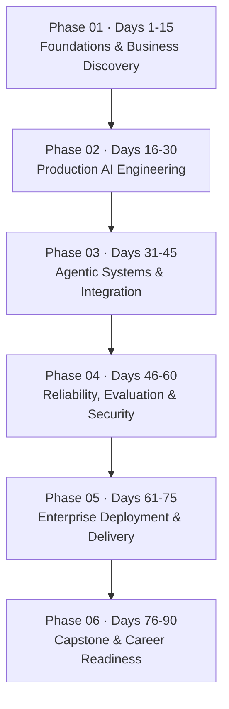
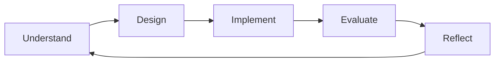
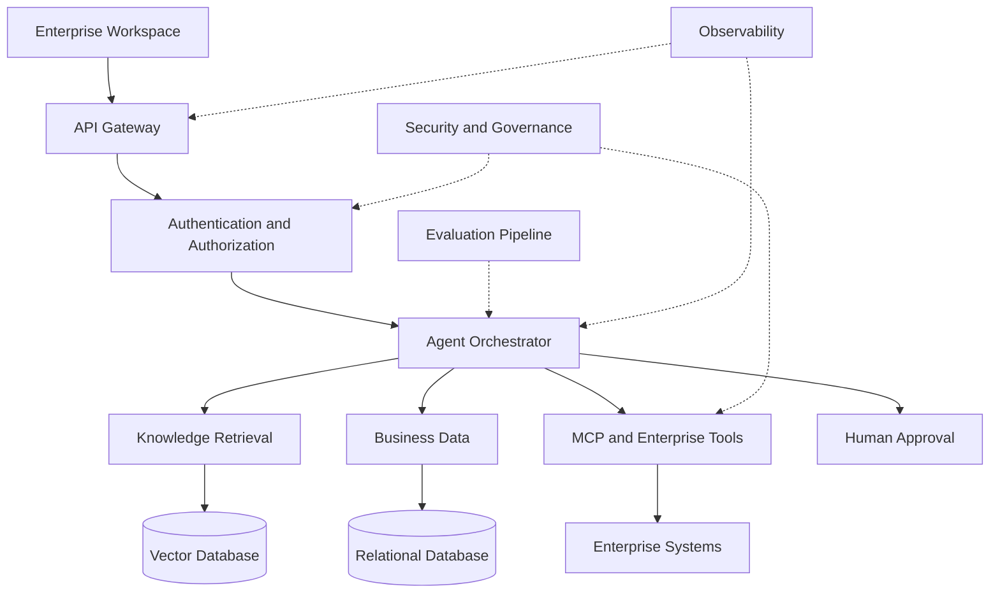

<div align="center">

# 90 Days to FDE

### From Software Engineer to Forward Deployed Engineer

**90 days. Real challenges. Real engineering.**

An open-source, hands-on curriculum for software engineers who want to build, evaluate, secure, and deploy enterprise-grade AI systems.

[](./LICENSE)
[](./LICENSE-CONTENT.md)
[](./CONTRIBUTING.md)
[](https://github.com/sebamar88/90-days-to-fde/stargazers)
[](https://github.com/sebamar88/90-days-to-fde/issues)
[](https://github.com/sebamar88/90-days-to-fde)

[Roadmap](#-learning-roadmap) ·
[Getting Started](#-getting-started) ·
[Community](https://github.com/sebamar88/90-days-to-fde/discussions) ·
[Contributing](#-contributing) ·
[Support](#-support-the-project)

---

**Learn. Build. Deploy. Deliver.**

</div>

> [!IMPORTANT]
> This project is currently under active development.
> The curriculum, exercises, labs, and learning resources
> are being developed progressively.
> Star and watch the repository to follow its progress.

## 📖 Table of Contents

- [About](#-about)
- [What Is a Forward Deployed Engineer?](#-what-is-a-forward-deployed-engineer)
- [Why This Project Exists](#-why-this-project-exists)
- [Who Is This For?](#-who-is-this-for)
- [What You Will Learn](#-what-you-will-learn)
- [Learning Roadmap](#-learning-roadmap)
- [Technology Stack](#-technology-stack)
- [Learning Methodology](#-learning-methodology)
- [Enterprise Simulations](#-enterprise-simulations)
- [Capstone Project](#-capstone-project)
- [Assessment Framework](#-assessment-framework)
- [Repository Structure](#-repository-structure)
- [Getting Started](#-getting-started)
- [Project Status](#-project-status)
- [Community](#-community)
- [Contributing](#-contributing)
- [Project Vision](#-project-vision)
- [Support the Project](#-support-the-project)
- [License](#-license)
- [Disclaimer](#-disclaimer)

## 🎯 About

**90 Days to FDE** is a free, open-source learning initiative designed to bridge the gap between traditional software engineering and Forward Deployed Engineering.

The goal is not simply to teach developers how to use AI frameworks, build chatbots, or consume LLM APIs.

The goal is to develop engineers capable of:

- Understanding complex business problems.
- Discovering meaningful opportunities for AI.
- Designing production-grade architectures.
- Integrating AI into existing enterprise systems.
- Evaluating and securing non-deterministic applications.
- Deploying and operating reliable solutions.
- Communicating technical decisions to stakeholders.
- Delivering measurable business outcomes.

This curriculum combines software engineering, applied AI, system design, technical consulting, and enterprise delivery into a single practical learning experience.

## 🧭 What Is a Forward Deployed Engineer?

A Forward Deployed Engineer (FDE) works at the intersection of software engineering, customer needs, architecture, and business outcomes.

Unlike roles that focus primarily on building isolated product features, an FDE often works directly with customers to understand their challenges and deliver solutions within real operational environments.

An FDE must be comfortable working across multiple disciplines:

| Discipline | Responsibility |
| --- | --- |
| Software Engineering | Build maintainable and reliable systems |
| Applied AI | Design intelligent applications and workflows |
| System Design | Make architectural decisions and trade-offs |
| Business Discovery | Understand customer needs and processes |
| Enterprise Integration | Connect solutions to existing systems |
| Security | Protect data, permissions, and operations |
| Technical Consulting | Communicate solutions and manage expectations |
| Delivery | Deploy, operate, and measure business impact |

The exact responsibilities of an FDE vary between organizations.

This curriculum focuses on the engineering and delivery capabilities required to build enterprise-grade applied AI solutions.

## 💡 Why This Project Exists

Learning how to build an AI agent is increasingly accessible.

Learning how to deploy that agent inside an enterprise, integrate it with existing systems, secure its permissions, measure its reliability, and demonstrate its business value is a different challenge.

Many educational resources focus on:

- Framework tutorials.
- Prompt engineering.
- Chatbot demonstrations.
- Isolated proof-of-concept applications.
- Happy-path implementations.

Real-world engineering requires more.

It requires handling ambiguous requirements, legacy systems, unexpected failures, security constraints, infrastructure limitations, changing priorities, and demanding stakeholders.

**90 Days to FDE** aims to address that gap.

### Our Principles

| Principle | Description |
| --- | --- |
| Production First | Build for real operational environments |
| Learn by Building | Apply every major concept through practical work |
| Business Driven | Start with problems, not technologies |
| Security by Design | Treat security as a fundamental requirement |
| Evaluation First | Measure quality instead of assuming it |
| Architecture Matters | Understand and document technical trade-offs |
| Free First | Prefer accessible, open-source learning paths |
| Provider Agnostic | Avoid unnecessary vendor lock-in |
| Community Driven | Learn, improve, and build together |

## 👨‍💻 Who Is This For?

This curriculum is designed for engineers who already have foundational software development experience.

### Target Audience

- Software Engineers
- Frontend Engineers
- Backend Engineers
- Full Stack Engineers
- AI Engineers
- Technical Leads
- Solutions Architects
- Cloud Engineers
- Developers transitioning into enterprise AI

### Prerequisites

You should ideally have experience with:

- At least one programming language.
- Git and GitHub.
- Command-line tools.
- REST APIs.
- Basic database concepts.
- Software engineering fundamentals.
- Basic automated testing.

Prior experience with machine learning, LLMs, or AI agents is helpful but not mandatory.

> [!NOTE]
> This is not an introductory programming course.
> Learners without software engineering experience may
> need additional preparation before starting.

## 🎓 What You Will Learn

By completing the curriculum and its practical assessments, you should develop the ability to:

### Business & Discovery

- Conduct customer discovery sessions.
- Map business processes.
- Identify opportunities for automation and AI.
- Define measurable success criteria.
- Estimate implementation costs and potential ROI.
- Manage technical requirements and stakeholder expectations.

### Applied AI Engineering

- Work with commercial and local LLMs.
- Design provider-independent AI applications.
- Implement structured outputs and tool calling.
- Apply context engineering techniques.
- Build advanced RAG pipelines.
- Implement reliable agentic workflows.
- Design human-in-the-loop systems.

### Enterprise Integration

- Integrate legacy APIs and enterprise platforms.
- Build MCP servers and clients.
- Implement authentication and authorization.
- Work with event-driven architectures.
- Handle asynchronous workflows and webhooks.
- Design resilient integration strategies.

### Reliability, Evaluation & Security

- Build automated evaluation pipelines.
- Evaluate RAG and agent performance.
- Implement AI regression testing.
- Understand prompt injection and adversarial attacks.
- Design secure tool execution.
- Implement observability and distributed tracing.
- Handle failures and production incidents.

### Deployment & Delivery

- Containerize and deploy AI applications.
- Implement infrastructure as code.
- Design CI/CD pipelines.
- Optimize infrastructure and inference costs.
- Deliver technical documentation.
- Communicate architecture and business outcomes.
- Support production adoption and operational handover.

## 🗺️ Learning Roadmap

The curriculum is organized into six progressive phases.

Each phase combines theory, practical exercises, enterprise scenarios, and technical assessments.



| Phase | Days | Focus | Status |
| --- | --- | --- | --- |
| 01 | 001–015 | Foundations & Business Discovery | 🚧 In development |
| 02 | 016–030 | Production AI Engineering | 📋 Planned |
| 03 | 031–045 | Agentic Systems & Enterprise Integration | 📋 Planned |
| 04 | 046–060 | Reliability, Evaluation & Security | 📋 Planned |
| 05 | 061–075 | Enterprise Deployment & Delivery | 📋 Planned |
| 06 | 076–090 | Capstone & Career Readiness | 📋 Planned |

### Phase 01 — Foundations & Business Discovery

**Days 001–015**

Develop the engineering foundations and customer-facing mindset required to operate as an FDE.

Topics:

- The Forward Deployed Engineer role.
- Business discovery and customer interviews.
- Process mapping and opportunity identification.
- Requirements engineering.
- Success metrics and business KPIs.
- Technical feasibility.
- Advanced Python engineering.
- Asynchronous programming.
- FastAPI and Pydantic.
- Software architecture.
- Automated testing.
- LLM fundamentals.

**Phase deliverable:**

A technical discovery document, business case, architecture proposal, and foundational AI-enabled backend.

### Phase 02 — Production AI Engineering

**Days 016–030**

Move beyond basic LLM integrations and learn to build reliable AI-powered applications.

Topics:

- LLM architecture and inference fundamentals.
- Structured outputs.
- Tool calling.
- Prompt engineering.
- Context engineering.
- Model routing and fallbacks.
- Token budgets and cost optimization.
- Embeddings.
- Vector databases.
- Advanced RAG.
- Hybrid retrieval.
- Reranking.
- Retrieval evaluation.
- Permission-aware knowledge retrieval.

**Phase deliverable:**

A provider-agnostic AI service with an evaluated, permission-aware RAG pipeline.

### Phase 03 — Agentic Systems & Enterprise Integration

**Days 031–045**

Build intelligent systems that interact with enterprise applications and execute reliable business workflows.

Topics:

- Agent architecture and design patterns.
- State machines and workflow orchestration.
- LangGraph.
- Multi-agent systems.
- Durable execution.
- Checkpointing and state persistence.
- Human-in-the-loop.
- Model Context Protocol (MCP).
- Agent-to-Agent communication.
- Legacy API integration.
- Authentication and authorization.
- Event-driven architectures.
- CRM and ERP integrations.

**Phase deliverable:**

An enterprise agentic workflow connected to external systems, with persistent state and human approval mechanisms.

### Phase 04 — Reliability, Evaluation & Security

**Days 046–060**

Learn how to measure, improve, secure, and operate AI applications.

Topics:

- Evaluation-driven development.
- Golden datasets.
- AI regression testing.
- LLM-as-a-Judge.
- Agent trajectory evaluation.
- RAG evaluation.
- Prompt injection.
- AI red teaming.
- Tool execution security.
- Data privacy.
- Governance and auditability.
- OpenTelemetry.
- Distributed tracing.
- Reliability engineering.
- Failure recovery.

**Phase deliverable:**

An automated evaluation pipeline, threat model, adversarial test suite, and observable AI application.

### Phase 05 — Enterprise Deployment & Delivery

**Days 061–075**

Take AI solutions from development into operational enterprise environments.

Topics:

- Docker and containerization.
- Cloud infrastructure.
- AWS and alternative deployment environments.
- Infrastructure as code.
- Terraform.
- CI/CD.
- Secrets management.
- Multi-tenancy.
- Scalability.
- Cost optimization.
- Incident management.
- Stakeholder communication.
- Change management.
- Business value measurement.
- Technical handover.

**Phase deliverable:**

A reproducible deployment with infrastructure as code, operational documentation, monitoring, and a business value assessment.

### Phase 06 — Capstone & Career Readiness

**Days 076–090**

Apply everything learned throughout the curriculum to a realistic enterprise implementation.

Topics:

- End-to-end system design.
- Architecture decision records.
- Enterprise implementation.
- Performance optimization.
- Security hardening.
- Production readiness reviews.
- Technical documentation.
- Executive presentations.
- System design interviews.
- FDE interview preparation.
- Architecture defense.

**Phase deliverable:**

A portfolio-ready enterprise AI solution with code, architecture documentation, evaluation results, deployment instructions, and a final technical presentation.

## 🛠️ Technology Stack

The curriculum emphasizes transferable engineering concepts rather than dependence on specific frameworks.

The following technologies represent the proposed reference stack. Individual lessons may introduce alternatives when appropriate.

| Category | Technologies |
| --- | --- |
| Languages | Python, TypeScript, SQL |
| Backend | FastAPI, Pydantic, SQLAlchemy |
| Frontend | React, Next.js |
| AI Providers | OpenAI, Anthropic, AWS Bedrock |
| Local Inference | Ollama, llama.cpp |
| Agent Frameworks | LangGraph, AWS Bedrock AgentCore |
| Protocols | MCP, A2A, REST, Webhooks |
| Databases | PostgreSQL, Redis |
| Vector Search | Qdrant, pgvector |
| Testing | pytest, Vitest |
| AI Evaluation | Ragas, Agentest, custom evaluation pipelines |
| Observability | OpenTelemetry, Langfuse |
| Infrastructure | Docker, Terraform, AWS |
| CI/CD | GitHub Actions |
| Security | OAuth 2.0, OpenID Connect, RBAC |
| Documentation | Markdown, Mermaid, ADRs |

### Provider Independence

Where possible, implementations should support interchangeable model providers.

Learners should understand when to use:

- Commercial model APIs.
- Open-weight models.
- Local inference.
- Cloud-managed inference.
- Hybrid architectures.

No specific AI provider should be treated as the universal solution to every problem.

### Free-First Learning

The curriculum aims to provide free or local alternatives whenever practical.

Some optional cloud deployments, commercial APIs, and managed infrastructure may incur costs.

No paid subscription should be required to access the public curriculum.

## 📚 Learning Methodology

The program is structured around 90 learning sessions.

| Metric | Target |
| --- | --- |
| Learning sessions | 90 |
| Phases | 6 |
| Recommended daily commitment | 3 hours |
| Estimated total commitment | 270 hours |
| Difficulty | Intermediate to advanced |
| Primary language | English |
| Learning format | Self-paced |
| Curriculum access | Free |

The schedule is flexible. Learners can follow the program daily, on weekdays, or at their own pace.

### Daily Lesson Structure

Each lesson is intended to follow a consistent learning format.

| Activity | Estimated Time |
| --- | --- |
| Learning Objectives | 5 minutes |
| Theory and Concepts | 30 minutes |
| Selected Resources | 20 minutes |
| Hands-on Implementation | 75 minutes |
| Real-world Challenge | 30 minutes |
| Knowledge Assessment | 15 minutes |
| Reflection | 5 minutes |

### Learning Cycle



The goal is not to memorize frameworks.

The goal is to understand engineering principles, apply them to real problems, and defend the resulting technical decisions.

### Definition of Done

A lesson should be considered complete when the learner can:

- [ ] Explain the core concepts.
- [ ] Complete the required practical exercise.
- [ ] Pass the relevant automated tests.
- [ ] Identify important technical trade-offs.
- [ ] Explain how the solution behaves under failure.
- [ ] Document the key architectural decisions.
- [ ] Identify potential security and operational risks.

## 🏢 Enterprise Simulations

Real enterprise engineering rarely starts with complete requirements and perfectly documented APIs.

Throughout the curriculum, learners will encounter fictional companies with realistic engineering and business challenges.

Planned simulation categories include:

| Industry | Example Challenge |
| --- | --- |
| Logistics | Intelligent operations and shipment workflows |
| Financial Services | Secure document processing and analysis |
| Retail | Enterprise knowledge and inventory automation |
| Customer Support | Agent-assisted ticket resolution |
| Insurance | Claims processing and document intelligence |
| Manufacturing | Operational knowledge and incident workflows |

Each simulation may introduce:

- Ambiguous requirements.
- Stakeholder interviews.
- Technical constraints.
- Budget limitations.
- Legacy infrastructure.
- Security and compliance requirements.
- Incomplete documentation.
- Production incidents.
- Changing priorities.
- Conflicting stakeholder expectations.

All scenarios must use synthetic, fictional, or appropriately licensed data.

The objective is to practice solving problems under realistic constraints, not simply completing isolated coding tasks.

## 🚀 Capstone Project

### Enterprise AI Operations Platform

The reference capstone is a complete enterprise AI solution developed progressively throughout the curriculum.

The proposed platform enables organizations to interact with internal knowledge, business data, and operational systems through controlled AI workflows.

### Reference Architecture



This architecture is illustrative, not mandatory.

Learners are expected to challenge assumptions and justify the components required by their chosen business scenario.

### Expected Capstone Deliverables

- Business discovery document.
- Requirements and success criteria.
- System architecture.
- Architecture decision records.
- Source code.
- Automated tests.
- AI evaluation dataset.
- Evaluation results.
- Threat model.
- Infrastructure as code.
- Deployment pipeline.
- Observability configuration.
- Operational runbook.
- Cost analysis.
- Business value assessment.
- Technical presentation.

The final outcome should demonstrate both engineering competence and the ability to deliver business value.

## 📊 Assessment Framework

AI applications cannot be evaluated solely by whether their code executes successfully.

The curriculum proposes a multidimensional assessment framework.

| Evaluation Area | Weight |
| --- | ---: |
| Practical Implementation | 30% |
| Architecture & Technical Decisions | 25% |
| Testing, Reliability & Security | 20% |
| Theoretical Understanding | 15% |
| Technical Communication | 10% |
| **Total** | **100%** |

The recommended passing score is 80%.

### Assessment Methods

- Automated unit tests.
- Integration tests.
- AI evaluation pipelines.
- Architecture reviews.
- Security reviews.
- Technical quizzes.
- Practical challenges.
- Incident simulations.
- System design exercises.
- Architecture defense.

The assessment framework is intended for learning and self-assessment.

It does not represent an accredited professional certification.

## 📁 Repository Structure

The planned repository structure is:

```text
90-days-to-fde/
├── .github/
│   ├── ISSUE_TEMPLATE/
│   ├── workflows/
│   ├── FUNDING.yml
│   └── pull_request_template.md
│
├── curriculum/
│   ├── 01-foundations/
│   ├── 02-production-ai/
│   ├── 03-agentic-systems/
│   ├── 04-reliability-security/
│   ├── 05-enterprise-delivery/
│   └── 06-capstone/
│
├── labs/
├── projects/
├── case-studies/
├── assessments/
├── interview-prep/
├── resources/
├── templates/
├── scripts/
│
├── README.md
├── ROADMAP.md
├── CONTRIBUTING.md
├── CODE_OF_CONDUCT.md
├── SECURITY.md
├── LICENSE
└── LICENSE-CONTENT.md
```

### Lesson Structure

Each lesson directory is intended to follow this convention:

```text
day-001/
├── README.md
├── theory.md
├── exercise.md
├── resources.md
├── assessment.md
├── starter/
├── solution/
└── tests/
```

Not every lesson will require executable code.

Business discovery, architecture, and consulting lessons may include documents, diagrams, simulations, and scenario-based assessments instead.

## ⚡ Getting Started

### 1. Star the Repository

If you find this initiative useful, consider starring the repository to support its growth.

### 2. Fork the Repository

Create your own fork to track your learning progress and maintain your implementations.

### 3. Clone Your Fork

```bash
git clone https://github.com/YOUR_USERNAME/90-days-to-fde.git

cd 90-days-to-fde
```

Alternatively, clone the original repository:

```bash
git clone https://github.com/sebamar88/90-days-to-fde.git

cd 90-days-to-fde
```

### 4. Prepare Your Environment

The recommended foundational environment includes:

- Python 3.12 or newer.
- A supported Node.js LTS release.
- Git.
- Docker.
- An IDE or code editor.
- A GitHub account.

Additional tools and dependencies will be introduced within individual lessons.

Follow the version requirements specified by each exercise.

### 5. Follow the Learning Roadmap

Review the learning roadmap and start with Phase 01 when its lessons become available.

### 6. Join the Community

Introduce yourself in GitHub Discussions and share your learning goals.

[Join the discussion →](https://github.com/sebamar88/90-days-to-fde/discussions)

### 7. Build in Public

Share your implementations, architectural decisions, mistakes, lessons, and progress.

Use the hashtag **#90DaysToFDE** when sharing your journey.

## 📋 Project Status

This project is being developed incrementally.

The following checklist represents the planned public launch and curriculum development.

### Initial Launch

- [x] Define the project vision.
- [x] Define the curriculum phases.
- [ ] Complete the detailed 90-day roadmap.
- [ ] Establish contribution standards.
- [ ] Establish licensing policies.
- [ ] Create lesson and assessment templates.
- [ ] Implement automated content validation.
- [ ] Publish the first 15 lessons.
- [ ] Release the initial enterprise lab.
- [ ] Launch the project website.

### Curriculum Development

- [ ] Phase 01 — Foundations & Business Discovery.
- [ ] Phase 02 — Production AI Engineering.
- [ ] Phase 03 — Agentic Systems & Enterprise Integration.
- [ ] Phase 04 — Reliability, Evaluation & Security.
- [ ] Phase 05 — Enterprise Deployment & Delivery.
- [ ] Phase 06 — Capstone & Career Readiness.
- [ ] Reference capstone implementation.
- [ ] Interview preparation collection.

Follow the repository issues and discussions for development updates.

## 🌍 Community

We believe that learning is more effective when knowledge is shared openly.

GitHub Discussions is the primary space for our community.

You can use it to:

- Introduce yourself.
- Ask technical questions.
- Share your learning progress.
- Discuss architectural decisions.
- Recommend learning resources.
- Showcase your projects.
- Suggest curriculum improvements.
- Connect with other engineers.
- Discuss career opportunities.

[Join GitHub Discussions](https://github.com/sebamar88/90-days-to-fde/discussions)

### Community Values

- Be curious.
- Be respectful.
- Challenge ideas, not people.
- Share knowledge openly.
- Favor practical experience over hype.
- Learn from failures.
- Build things that matter.

## 🤝 Contributing

Contributions are welcome.

You do not need to be an AI expert or an experienced Forward Deployed Engineer to contribute.

### Ways to Contribute

- Improve technical explanations.
- Fix errors and outdated content.
- Create practical exercises.
- Propose enterprise scenarios.
- Develop automated tests.
- Improve evaluation pipelines.
- Review architectural decisions.
- Recommend high-quality resources.
- Improve accessibility and developer experience.
- Share feedback from your learning journey.

### Contribution Workflow

1. Search existing issues and discussions.
2. Open an issue or discuss your proposal.
3. Fork the repository.
4. Create a descriptive branch.
5. Implement your contribution.
6. Run relevant validation and tests.
7. Submit a pull request.
8. Participate in the review process.

### Branch Naming

```text
feat/day-001-discovery-exercise
fix/day-012-python-example
docs/improve-contributing-guide
lab/enterprise-logistics-scenario
```

### Commit Convention

This project intends to follow Conventional Commits.

```text
feat(curriculum): add business discovery lesson
fix(lab): correct authentication example
docs(readme): improve getting started guide
test(evals): add agent regression tests
```

### Contribution Standards

All contributions should:

- Be technically accurate.
- Provide meaningful educational value.
- Respect third-party licenses.
- Avoid confidential or proprietary customer data.
- Follow the repository conventions.
- Include tests where appropriate.
- Clearly communicate technical trade-offs.
- Prefer official documentation and primary sources.

Read the contribution guidelines before submitting a pull request.

[Browse open issues](https://github.com/sebamar88/90-days-to-fde/issues)

## 🔭 Project Vision

90 Days to FDE aims to become an open learning ecosystem for applied AI and Forward Deployed Engineering.

The long-term vision includes:

- A complete open-source curriculum.
- A collection of realistic enterprise challenges.
- Interactive learning experiences.
- Automated engineering assessments.
- Community-driven learning paths.
- Interview preparation resources.
- Advanced enterprise labs.
- An interactive FDE Simulator.

### FDE Simulator

One of the project's long-term concepts is a simulated enterprise environment where engineers can practice the complete FDE lifecycle.

Learners could interact with simulated stakeholders, discover requirements, design solutions, respond to incidents, and defend their architectural decisions.

This is a future concept, not a currently available product.

### Sustainability

The core public curriculum is intended to remain freely accessible.

Optional commercial products, hosted services, mentorship, advanced labs, or enterprise training may be introduced in the future to support the project's sustainability.

These offerings will be separate from the open curriculum.

## ❤️ Support the Project

Building and maintaining high-quality educational resources requires time, research, development, and continuous improvement.

You can support this initiative without spending money.

- ⭐ Star the repository.
- 🍴 Fork the project.
- 📢 Share it with other engineers.
- 💬 Participate in discussions.
- 🐛 Report issues.
- 🛠️ Contribute improvements.
- 📚 Share useful resources.
- 🌍 Help grow the community.

Financial sponsorship options will be made available as the project grows.

Your support helps make practical engineering education more accessible.

## 🔒 Security

Security is a fundamental part of this project.

If you discover a security vulnerability:

- Do not disclose secrets or sensitive information publicly.
- Do not include real customer data in issues.
- Follow the repository's security reporting policy when available.

Use synthetic data and isolated environments when performing security-related exercises.

## 📄 License

The intended licensing model separates source code from educational content.

| Component | License |
| --- | --- |
| Source code and examples | MIT |
| Educational content | Creative Commons BY-SA 4.0 |
| Documentation | Creative Commons BY-SA 4.0 |
| Third-party resources | Their respective licenses |
| Project branding | Not included in the open-source license |

The applicable license files will define the exact terms.

External resources and dependencies remain subject to their respective licenses.

Please respect attribution requirements and avoid contributing copyrighted material without appropriate authorization.

## ⚠️ Disclaimer

90 Days to FDE is an independent educational initiative.

It is not affiliated with or endorsed by OpenAI, Anthropic, Google, AWS, Palantir, or any other technology provider.

The curriculum does not guarantee employment, professional certification, or a specific career outcome.

The 90-day structure is a suggested learning framework rather than a guarantee of professional proficiency within a fixed period.

All enterprise simulations are fictional unless explicitly stated otherwise.

## 👤 Founder & Maintainer

**Sebastián Martínez**

Software Engineer and open-source contributor, focused on software architecture, applied AI, agentic systems, and enterprise engineering.

- [GitHub](https://github.com/sebamar88)

## 🙏 Acknowledgments

This initiative is made possible by the open-source community, researchers, engineers, educators, and maintainers who make technical knowledge accessible.

External learning resources will be attributed throughout the curriculum.

Thank you to everyone who contributes, learns, shares feedback, and helps improve this project.

---

<div align="center">

## Build systems that matter.

### 90 days. Real challenges. Real engineering.

**Learn. Build. Deploy. Deliver.**

[](https://github.com/sebamar88/90-days-to-fde)

**Made for engineers, by engineers.**

</div>
